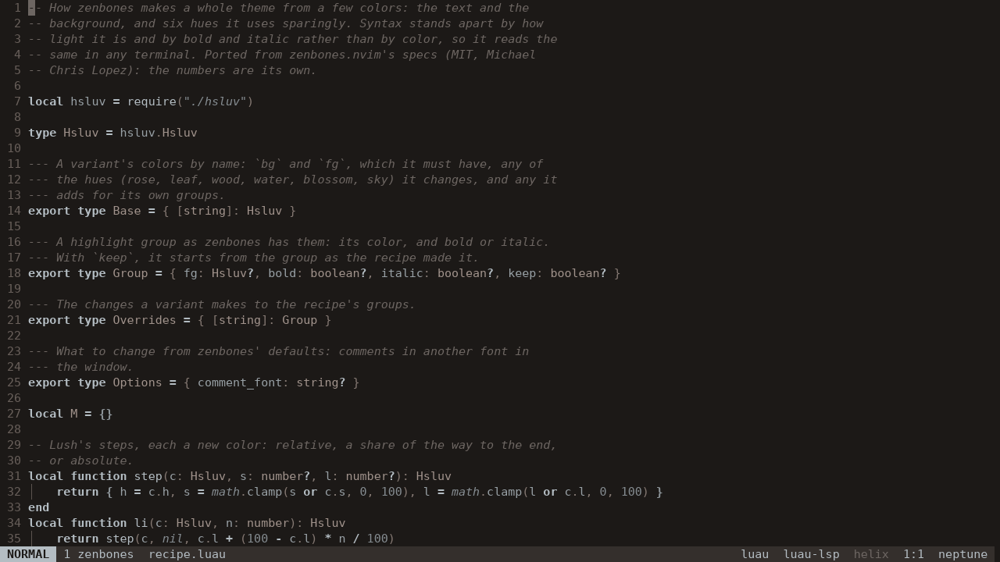

Zenbones for [Greed](https://greed.rs): themes that tell code apart by
contrast, bold and italic instead of a rainbow of colors. A port of
[zenbones.nvim](https://github.com/zenbones-theme/zenbones.nvim), with its
colors and its recipe.



Keywords are bold, strings and comments italic, types and punctuation a
shade lighter or darker than the text. Since that's mostly bold and italic,
it looks the same in a terminal as in Greed's window.

## Install

In your `init.luau`:

```luau
require("@git-plugins").use("https://github.com/johnae/greed-zenbones")
require("@theme").use("zenbones")
```

Greed fetches it in the background the first time, pins it in
`plugins.lock` next to your config, and `:plugins-update` moves it on.
`:theme` lists the variants to try.

The [docs](docs/README.md) have the twelve variants, comments in a font of
their own and how the colors are worked out. Once it's installed, Greed's
`:docs` shows them too.

## Working on it

`greed check .` checks the types and runs the tests. Colors are worked
out in HSLuv, as zenbones does (`hsluv.luau`); `recipe.luau` turns a
variant's few colors into a theme, and `variants.luau` has each variant.

MIT, like zenbones. Thanks to Michael Chris Lopez for zenbones itself.
