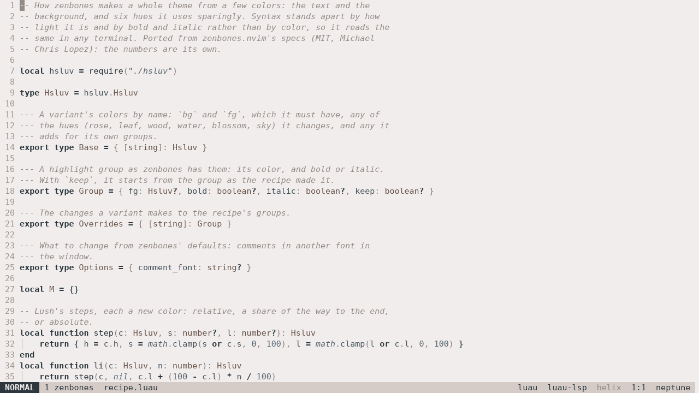

# Zenbones

Themes for Greed that tell code apart by contrast, bold and italic. Keywords
are bold, strings and comments italic, types and punctuation a shade lighter
or darker than the text, and color is kept for the few things that need it,
like errors and changed lines. It's a port of
[zenbones.nvim](https://github.com/zenbones-theme/zenbones.nvim), with its
colors and its recipe.




## Using it

Add the plugin and pick the theme in your `init.luau`:

```luau
require("@git-plugins").use("https://github.com/johnae/greed-zenbones")
require("@theme").use("zenbones")
```

Greed fetches it in the background the first time and the theme shows once
it's there. `:theme` lists every variant and tries each as you move
through them, and Greed remembers the one you pick.

## The variants

Each comes dark as its name and light as `NAME-light`, like
`zenbones-light`. Those with only one side go by the name alone.

| Theme | |
|---|---|
| `zenbones` | The original |
| `zenwritten` | No hue at all in the text and background |
| `neobones` | Inspired by neovim.io |
| `vimbones` | Inspired by vim.org, light only |
| `rosebones` | Inspired by Rosé Pine |
| `forestbones` | Inspired by Everforest |
| `nordbones` | Inspired by Nord, dark only |
| `tokyobones` | Inspired by Tokyo Night |
| `seoulbones` | Inspired by Seoul256 |
| `duckbones` | Inspired by Spaceduck, dark only |
| `zenburned` | Inspired by Zenburn, dark only |
| `kanagawabones` | Inspired by Kanagawa, dark only |

## Comments in another font

In Greed's window, comments can go in a family of their own:

```luau
local greed = require("@greed")
greed.option.set("gui-font", "Monaspace Neon")
greed.option.set("zenbones-comment-font", "Monaspace Radon")
```

Families made to share a grid work best, like Monaspace's, where a
handwritten Radon lines up with Neon for the code. Changing the option
shows at once, and setting it back to `""` puts comments in the code's
font again. The terminal keeps comments italic either way.

## Changing a color or two

Greed's `greed.theme.set` changes single styles on top of whichever theme
is in use, so it works with these too:

```luau
require("@greed").theme.set({ comment = { italic = false } })
```

It changes only what you give and stays when you switch variants.
Greed's [highlighting docs](https://greed.rs/docs/highlighting.html) list
the style names.

## How it works

Like zenbones, each variant is a handful of colors in
[HSLuv](https://www.hsluv.org): a background, the text, and six hues
(rose, leaf, wood, water, blossom, sky). The recipe in `recipe.luau`
works out every style from those by making them lighter, darker or less
saturated, the same steps zenbones takes with lush, and `variants.luau`
has each variant's colors and what it does differently. HSLuv keeps
lightness even across hues, which is what lets the recipe make text a
shade lighter without it turning another color.

Making your own variant from the recipe isn't something the plugin offers
yet. If you'd like that, open an issue.
